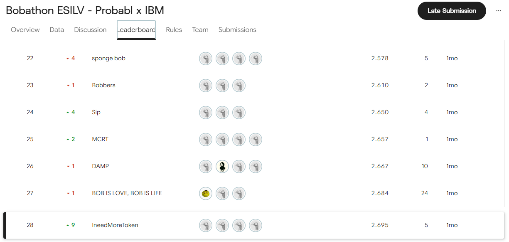

# Prédiction de la sévérité de la maladie de Parkinson (MDS-UPDRS III)

**Bobathon IBM × Probabl · compétition Kaggle · octobre 2026 · 28ᵉ sur 294 équipes**

> 🇬🇧 *Predict the true OFF-medication MDS-UPDRS motor score of Parkinson's patients from noisy,
> rater-biased clinical visits. Patient-level longitudinal features, multiplicative rater-bias
> correction, drug-timing normalisation and a two-stage stacked HistGradientBoosting model,
> validated with patient-grouped cross-validation. Private leaderboard RMSE 2.70, rank 28/294.*

| Résultat | Valeur |
|---|---|
| Classement final (leaderboard privé) | **28ᵉ / 294** |
| RMSE privé · public | **2,695** · 2,918 |
| RMSE en validation croisée groupée par patient | 2,88 ± 0,04 |
| Gain par rapport à une régression Ridge (même validation) | 10,60 → 2,88 : **erreur divisée par 3,7** |



## Le problème

Le score moteur MDS-UPDRS (partie III) mesure la sévérité de la maladie de Parkinson. Chaque
mesure est bruitée : **chaque clinicien note selon sa propre échelle**, et le score dépend du
**moment de la visite par rapport à la prise du traitement** (lévodopa).

Objectif : à partir de 44 590 visites de 5 576 patients, prédire le score « OFF » réel
(sans effet du médicament) de 11 013 visites de **1 395 patients jamais vus**. Métrique : RMSE.

## Les données

Données **synthétiques** fournies par les organisateurs, construites pour reproduire la
structure, les relations et les valeurs manquantes de cohortes cliniques réelles. Elles ne sont
**pas incluses** dans ce dépôt : il faut les télécharger depuis la page Kaggle de la compétition
(accès sur invitation) et placer `X_train.csv`, `y_train.csv`, `X_test.csv` et
`sample_submission.csv` dans un dossier `data/`.

## Démarche

1. **Validation sans fuite.** Toutes les expériences utilisent un `GroupKFold(5)` sur
   `patient_id` : les visites d'un même patient ne sont jamais à la fois en entraînement et en
   validation, comme dans la compétition, qui évalue des patients inconnus.
2. **Feature engineering longitudinal par patient.** Chaque visite est enrichie avec l'historique
   du patient : rang de la visite, agrégats, tendance du score en fonction de l'âge, mesures
   précédente et suivante, indicateurs de valeurs manquantes.
3. **Correction du biais de notation de chaque clinicien.** L'effet est multiplicatif :
   l'échelle propre à chaque évaluateur est apprise sur le fold d'entraînement uniquement,
   puis retirée des scores.
4. **Effet du traitement.** Une courbe de réponse au médicament, fonction du temps écoulé depuis
   la prise, est apprise puis corrigée. Le modèle s'appuie ensuite sur l'enveloppe supérieure des
   scores corrigés de chaque patient (le bruit fait surtout baisser les scores).
5. **Modèle empilé.** Un premier HistGradientBoosting produit des prédictions *out-of-fold* qui
   décrivent la trajectoire de chaque patient ; un second compare chaque visite à cette trajectoire.
   Un lissage polynomial (degré 2) par patient garantit une progression régulière.

| Étape | RMSE (CV groupée) |
|---|---|
| Prédiction de la moyenne | 16,50 |
| Régression Ridge | 10,60 |
| HistGradientBoosting brut | 7,57 |
| + features longitudinales par patient | 4,45 |
| + correction du biais clinicien et lissage | 3,99 |
| + échelle multiplicative et effet du traitement | 3,11 |
| **+ modèle empilé (modèle final)** | **2,88** |

La CV groupée (2,88) se situe entre les scores public (2,918) et privé (2,695) : elle a été un
guide fiable pour choisir les modèles. Détails de chaque étape : [`docs/JOURNAL.md`](docs/JOURNAL.md).

## Structure

```
src/parkinson/
  data.py        chargement des données, colonnes catégorielles
  evaluate.py    validation croisée groupée par patient
  pipeline.py    features patient, correction évaluateur, modèle empilé, lissage
  tracking.py    suivi optionnel des expériences sur skore Hub
experiments/     un script par expérience (10 = baselines, 24 = modèle final)
docs/JOURNAL.md  journal des expériences et des choix
```

## Lancer le projet

Python 3.11 ou plus récent (résultats obtenus avec Python 3.14).

```bash
python -m venv .venv
source .venv/bin/activate          # Windows : .venv\Scripts\activate
pip install -r requirements.txt
pip install -e .

python experiments/10_baselines.py            # baselines moyenne et Ridge
python experiments/24_hgb_envelope_stacked.py # modèle final : CV groupée + soumission
```

Chaque script affiche son RMSE et écrit sa soumission dans `submissions/`. Le suivi sur
skore Hub, utilisé pendant la compétition, ne s'active que si un fichier d'identifiants
`.skore` est présent ; sinon tout tourne en local.

## Équipe et rôle

Projet réalisé en équipe de quatre étudiants de l'ESILV, organisée en deux binômes :

- **Benjamin et Paul** : pipeline HistGradientBoosting (expériences 20 à 25), du modèle de base
  au modèle empilé final ;
- **Fabiola et Clément** : baselines linéaires et mise en place de la validation croisée
  groupée par patient.

**Benjamin Zilber — chef d'équipe.** Répartition des tâches entre les binômes, coordination de
l'équipe et gestion des soumissions Kaggle, en plus de l'analyse des données et de la
modélisation au sein du binôme HistGradientBoosting.

## Outils

Python · scikit-learn · pandas · NumPy · skore (suivi des expériences).
Conformément à la consigne du Bobathon, le code a été produit avec l'agent IA **IBM Bob**.
Notre travail a consisté à le piloter : formuler les hypothèses, orienter par nos prompts les
choix de features, de modèles et de validation, puis vérifier et analyser les résultats.

## Licence

Code sous licence [MIT](LICENSE). Les données et l'énoncé de la compétition appartiennent aux
organisateurs (IBM, Probabl) et ne sont pas redistribués ici.
